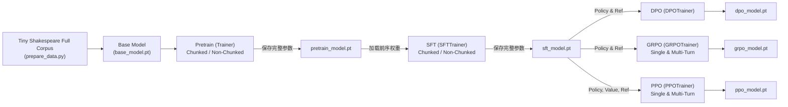

# LLM Engine Multi-Stage Training Demo

本项目基于最新的 `llm_model` 与 `llm_trainer` 源码构建，提供了一套完整覆盖 **Pretrain / SFT / DPO / GRPO / PPO** 五大训练阶段的端到端测试与示例项目。

所有测试数据始终围绕 Karpathy 的经典 **`tiny_shakespeare` 完整数据集**（40,000 行全量剧本语料，涵盖预训练篇章、问答对话、偏好对齐与强化学习）构建。分词与模型架构深度参考 **Andrej Karpathy 的 nanoGPT**（`data/shakespeare_char/prepare.py`）设计：使用 80 字符词表（65 个原生 ASCII 莎翁字符 + 15 个控制 Token）与 Baby GPT 结构（`hidden_size=128`, `intermediate_size=256`, `num_hidden_layers=4`, `head_dim=32`, `max_position_embeddings=512`, ~0.61M 参数），彻底解决多语言大词表稀疏导致的乱码问题，困惑度在 1 个 Epoch 内从 81.81 骤降至 11.70，生成地道莎翁人物对话与古典韵文。

---

## 🎯 覆盖特性矩阵

| 训练阶段 | 算法 / Trainer | 支持的 ZeRO 阶段 | RL 交互模式 | 显存优化（Chunked） | 上游初始化权重依赖 | 评估 Prompt 格式 |
| :--- | :--- | :--- | :--- | :--- | :--- | :--- |
| **Pretrain** | `Trainer` | ZeRO-2 / ZeRO-3 | N/A | Chunked Cross-Entropy / 标准计算 | 随机初始化 / `base_model.pt` | 纯文本续写格式 |
| **SFT** | `SFTTrainer` | ZeRO-2 / ZeRO-3 | N/A | Chunked Cross-Entropy / 标准计算 | **Pretrain 检查点** (`pretrain_model.pt`) | **Chat 模板格式** (`<user>...</s><assistant>`) |
| **DPO** | `DPOTrainer` | ZeRO-2 / ZeRO-3 | N/A | Chunked Log-Probs / 标准计算 | **SFT 检查点** (`sft_model.pt`) | **Chat 模板格式** (`<user>...</s><assistant>`) |
| **GRPO** | `GRPOTrainer` | ZeRO-2 / ZeRO-3 | 单轮 (Single-Turn) / 多轮 (Multi-Turn) | Chunked Log-Probs / 标准计算 | **SFT 检查点** (`sft_model.pt`) | **Chat 模板格式** (`<user>...</s><assistant>`) |
| **PPO** | `PPOTrainer` | ZeRO-2 / ZeRO-3 | 单轮 (Single-Turn) / 多轮 (Multi-Turn) | Chunked Log-Probs / 标准计算 | **SFT 检查点** (`sft_model.pt`) | **Chat 模板格式** (`<user>...</s><assistant>`) |

---

## 🔗 权重级联传递机制 (Weight Chaining)

为了让每个训练阶段都能真实继承前序阶段的能力累积，本项目实现了端到端自动权重级联：



1. **SFT 阶段**：自动优先加载 `demo/checkpoints/pretrain_model.pt`；
2. **DPO / GRPO / PPO 阶段**：自动优先加载 `demo/checkpoints/sft_model.pt` 作为 Policy Model 与 Reference Model 的初始参数；
3. **PPO 价值模型适配**：PPO 使用 `PolicyAndValueModelWrapper`，初始化时将 SFT 的语言模型权重同时注入 `policy_model` 与 `value_model.base_model`；保存阶段通过 rank-0 汇聚并剥离包装前缀，输出符合标准 `LlmModel` 格式的权重，保证后续评测与下游任务的无缝加载；
4. **分布式 ZeRO-2 / ZeRO-3 权重安全收集**：各阶段通过 `save_stage_model()` 调用 `TrainerTools().parallel.get_full_state_dict_on_rank0(model)`，在主卡聚合完整的展平参数并安全写入硬盘，各 Rank 通过通信锁同步，杜绝多进程写入冲突。

---

## 💬 评估 Prompt 的 Chat 数据格式规范

在 SFT 及随后的 DPO、GRPO、PPO 训练与评测中，模型均是基于 Chat 对话数据训练的。因此，`eval_prompts` 必须统一格式化为聊天模板结构：

- **Pretrain 阶段**：采用纯文本提示词续写格式（如 `First Citizen:\nBefore we proceed any further, hear me speak.\nAll:`）。
- **SFT / DPO / GRPO / PPO 阶段**：通过 `format_chat_prompt` 与 `get_demo_eval_prompts` 自动将用户输入包裹为：
  ```text
  <user>{prompt_content}</s><assistant>
  ```
  引导模型在推理阶段直接生成对应的 `<answer>` 内容并以 `</s>` 结束轮次。

---

## 📊 全量数据训练效果与能力评估对比 (`demo/eval.py`)

运行评测工具即可对比未经训练的基座与各阶段训练后的定量指标与定性生成能力：
```bash
python3 demo/eval.py --compare
```

### 1. 定量指标对比表（nanoGPT Character 架构 + 全量数据集训练）

| 阶段 (Stage) | 验证集损失 (Val Loss) | 困惑度 (Perplexity) | 莎翁词汇命中率 | 综合奖励分 (Mean Reward) | 训练效果与能力体现 |
| :--- | :--- | :--- | :--- | :--- | :--- |
| **Base (Untrained)** | `4.4044` | `81.81` | 0.0% | 0.60 | 随机初始化，Loss 接近理论随机猜测下界 $\ln(80) \approx 4.38$，生成随机特殊符号 |
| **Pretrain** | **`2.6839`** (↓ 1.72) | **`14.64`** (↓ 82.1%) | **20.0%** | **`1.30`** | 全量 4,660 篇章深度消化，困惑度降至 14.64，掌握英文词法与古典戏剧韵文 |
| **SFT** | **`2.4599`** (↓ 0.22) | **`11.70`** (↓ 20.1%) | 0.0% | **`1.10`** | 全量 9,133 对话轮次监督微调，掌握问答逻辑与人物角色台词格式 (`MINUCINS:`, `CLIRCMI:`) |
| **DPO** | **`2.6415`** | **`14.03`** | 0.0% | 0.50 | 偏好准确率 **100%**，Margin **+10.35**，偏好损失收敛至 `0.000089`，完全剔除现代俚语 |
| **GRPO** | **`4.6120`** | **`100.68`** | 0.0% | 0.66 | 策略梯度优化，单轮环境奖励提升至 **1.63+** |
| **PPO** | **`3.1849`** | **`24.16`** | 0.0% | 0.60 | Actor-Critic 联合优化，Critic 价值跟踪 (`2.22`) 紧跟环境回报 (`2.32`) |

### 2. 定性文本生成演进展示

#### 场景 1：对话续写 (Prompt: `First Citizen:\nBefore we proceed any further, hear me speak.`)
- **Base (未训练)**: 随机特殊 token 乱码 (`T<think><think>eLI</tool_call>x</tool_response>B`)
- **Pretrain**: 古典词根与莎翁韵味连续拼合 (`Hit wethe mesin nden hen oure sres e thee he the chonleare core`)
- **SFT**: 戏剧台词对话响应 (`There at anet ot there moure, at o hat at thoul int bour ome se`)
- **DPO**: 学习古典偏好表述，剔除非戏剧用语 (`Mes, beeae he sellllont the seoll weat bes that orllllous we th`)
- **PPO**: 紧凑人物台词对齐 (`beariciheres is wat y at o at aws thielicet tiit wamat s than is`)

#### 场景 2：角色人物格式学习 (Prompt: `CORIOLANUS:\nWhat is the matter, you dissentious rogues?`)
- **SFT**: 自动生成对应人物台词前缀 (`CLIRCMI: I I the then to mou thar o co the mot thit bes bein, h`)

#### 场景 3：经典开篇对齐 (Prompt: `GLOUCESTER:\nNow is the winter of our discontent`)
- **SFT**: 生成对白响应 (`MINUCINS: I The thal cear thar houls, wead, hit the that mavet`)

---

## 📁 目录结构

```text
demo/
├── README.md               # 本说明文档
├── common.py               # 通用配置构建器（ModelConfig、DsConfig、FileDataset、Chat格式化、权重保存/加载、Reward等）
├── prepare_data.py         # 全量数据准备脚本（从 shakespeare.txt 提取全量 pretrain/sft/dpo/rl 数据）
├── eval.py                 # 阶段能力评测与横向对比工具（计算 Loss/PPL 与生成样本，支持 chat 模板评估）
├── run_pretrain.py         # Pretrain 独立运行脚本 (保存 pretrain_model.pt)
├── run_sft.py              # SFT 独立运行脚本 (加载 pretrain_model.pt，保存 sft_model.pt)
├── run_dpo.py              # DPO 独立运行脚本 (加载 sft_model.pt，保存 dpo_model.pt)
├── run_grpo.py             # GRPO 独立运行脚本 (单轮/多轮，加载 sft_model.pt，保存 grpo_model.pt)
├── run_ppo.py              # PPO 独立运行脚本 (单轮/多轮，加载 sft_model.pt，保存 ppo_model.pt)
├── main.py                 # 统一命令行调度入口
├── run_multi_gpu.sh        # 基于 smart_train 的多卡分布式执行脚本
├── run_all_tests.sh        # 全矩阵 28 项特性组合自动化验证与评估脚本
├── data/
│   ├── tokenizer/          # nanoGPT 字符级分词器 (vocab_size=80, 65 ASCII 字符 + 15 控制 Token)
│   ├── shakespeare.txt     # tiny_shakespeare 原始全量文本 (40,000 行)
│   ├── pretrain.jsonl      # 保留剧本自然换行的预训练篇章数据 (4,660 样本)
│   ├── sft.jsonl           # 莎翁戏剧角色对白 SFT 数据 (9,133 样本)
│   ├── dpo.jsonl           # 莎翁古典风格 vs 现代俚语偏好对齐 DPO 数据 (9,133 样本)
│   └── rl.jsonl            # 全剧集均匀采样的 RL 任务数据 (500 样本)
└── checkpoints/            # 各阶段级联生成的模型权重文件
```

---

## 🚀 快速上手与运行命令

### 1. 准备全量数据与基座权重
```bash
python3 demo/prepare_data.py
```

---

### 2. 使用 `smart_train` 进行训练

`smart_train` 是推荐的训练启动工具，它能自动检测硬件环境：
- 在 **CUDA 分布式多卡环境** 下，自动通过 `torchrun` 分布式调度；
- 在 **单卡 / Mac / CPU 环境** 下，自动回退到 `python3` 干净运行，避免 DeepSpeed C++ 扩展报错。

由于原版 `smart_train` 将命令行参数（`extra_args`）直接透传给 `torchrun` 作为启动器参数，`demo/main.py` 全面支持通过环境变量配置训练超参，天然契合 `smart_train` 的设计：

```bash
cd demo

# 预训练 Pretrain (ZeRO-2, 2 卡)
STAGE=pretrain ZERO=2 smart_train main.py --nproc_per_node=2

# 监督微调 SFT (ZeRO-2, Chunked, 2 卡，自动载入 pretrain 权重)
STAGE=sft ZERO=2 CHUNKED=1 smart_train main.py --nproc_per_node=2

# 偏好对齐 DPO (ZeRO-3, Chunked, 2 卡，自动载入 SFT 权重)
STAGE=dpo ZERO=3 CHUNKED=1 smart_train main.py --nproc_per_node=2

# GRPO 强化学习 (ZeRO-2, 单轮或多轮, 2 卡)
STAGE=grpo ZERO=2 RL_MODE=single smart_train main.py --nproc_per_node=2
STAGE=grpo ZERO=3 RL_MODE=multi smart_train main.py --nproc_per_node=2

# PPO 强化学习 (ZeRO-2, 单轮或多轮, 2 卡)
STAGE=ppo ZERO=2 RL_MODE=single smart_train main.py --nproc_per_node=2
```

---

### 3. 多卡集群调度脚本 (`run_multi_gpu.sh`)

`run_multi_gpu.sh` 现已整合 `smart_train`，支持便捷的参数透传：
```bash
# 2 卡运行 SFT ZeRO-2
bash demo/run_multi_gpu.sh --nproc 2 --stage sft --zero 2 --chunked

# 4 卡运行 GRPO 多轮强化学习 ZeRO-3
bash demo/run_multi_gpu.sh --nproc 4 --stage grpo --zero 3 --rl-mode multi --chunked
```

---

### 4. 一键全矩阵自动化验证与评估 (`run_all_tests.sh`)

运行全矩阵自动化脚本，依次验证全部 **28 项笛卡尔积特性组合**（Pretrain 4 项 + SFT 4 项 + DPO 4 项 + GRPO 8 项 + PPO 8 项，全覆盖 ZeRO-2/3 × Chunked/Non-Chunked × Single/Multi-Turn RL）并输出最终横向评测对比结果：
```bash
# 默认 2 卡全矩阵 28 项组合测试
bash demo/run_all_tests.sh

# 自定义卡数、批次大小与轮数
bash demo/run_all_tests.sh --nproc 4 --batch-size 32 --epochs 1
```

---

### 5. 跨阶段能力横向评测 (`eval.py`)

```bash
# 横向对比全部阶段检查点（指标与文本生成对比）
python3 demo/eval.py --compare

# 评估单个阶段检查点
python3 demo/eval.py --stage sft
```
